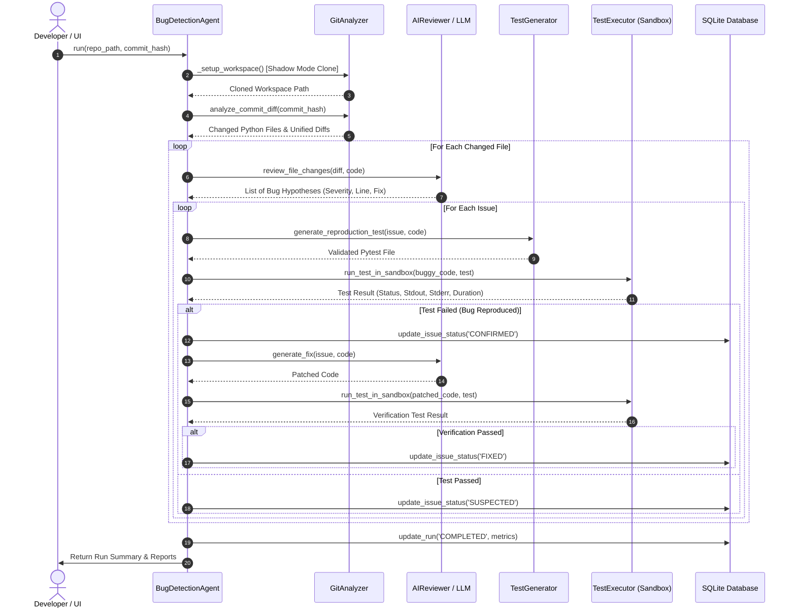

# Architecture Specification: Argus-AI Bug Detection Agent

Argus-AI is an autonomous, agentic system designed to analyze code diffs in Git repositories, synthesize bug hypotheses with Large Language Models (LLMs), generate targeted Pytest reproduction suites, execute them in an isolated sandboxed environment, and iteratively verify proposed code patches.

---

## 1. High-Level System Architecture

```mermaid
flowchart TD
    Trigger["Developer Trigger / Streamlit Dashboard / FastAPI Webhook"] --> Agent["Agent Orchestrator (agent.py)"]

    subgraph Phase 1: Workspace & Git
        Agent --> Shadow["Shadow Workspace Setup (.shadow_workspace)"]
        Shadow --> GitAnalyzer["Git Diff Analyzer (git_analyzer.py)"]
        GitAnalyzer --> ChangedFiles["Changed Files & Unified Diffs"]
    end

    subgraph Phase 2: AI Code Review
        ChangedFiles --> AIReviewer["AI Code Reviewer (ai_reviewer.py)"]
        AIReviewer --> LLM["LLM Provider (Gemini / OpenAI / Mock)"]
        LLM --> BugHypotheses["Structured Defect Hypotheses"]
    end

    subgraph Phase 3: Dynamic Test Synthesis
        BugHypotheses --> TestGen["Test Generator (test_generator.py)"]
        TestGen --> ASTValidator["AST Syntax & Import Sanitizer"]
        ASTValidator --> PytestSuites["Targeted Pytest Reproduction Suites"]
    end

    subgraph Phase 4: Sandboxed Isolation & Verification
        PytestSuites --> Sandbox["Sandboxed Subprocess Runner (test_executor.py)"]
        Sandbox --> EphemeralDir["Isolated Ephemeral Sandbox (tempfile)"]
        EphemeralDir --> BuggyRun["Run Pytest against Buggy Code"]
        BuggyRun -- Test Fails --> ConfirmedBug["Defect Confirmed via Reproduction"]
        BuggyRun -- Test Passes --> SuspectedBug["Defect Marked Suspected"]
        
        ConfirmedBug --> FixLoop["Autonomous Fix & Verification Loop"]
        FixLoop --> LLMFix["LLM Generates Code Patch"]
        LLMFix --> PatchedRun["Run Pytest against Patched Code"]
        PatchedRun -- Test Passes --> VerifiedFix["Fix Empirically Verified (Status: FIXED)"]
    end

    subgraph Phase 5: Storage, Telemetry & Export
        VerifiedFix --> Database["Relational Store (database.py / SQLite)"]
        Database --> Reports["Report Compiler (report_generator.py)"]
        Reports --> Markdown["Markdown Audit (.md)"]
        Reports --> HTML["Interactive HTML (.html)"]
        Reports --> JSON["Machine-readable JSON (.json)"]
        Database --> GitHubSync["GitHub Issue Sync (github_integration.py)"]
    end
```

---

## 2. Autonomous Agent Execution Loop

The agent operates through an empirical feedback loop:



---

## 3. Sandboxing & Isolation Guarantees

1. **Shadow Workspace Isolation:**  
   The agent never mutates the developer's working directory or commits. An ephemeral shadow clone is created in `.shadow_workspace/` for all operations.
2. **Restricted Subprocess Execution:**  
   Pytest runs in a separate process within a pristine temporary folder (`tempfile.mkdtemp`), stripped of host API credentials (`GEMINI_API_KEY`, `OPENAI_API_KEY`, `GITHUB_TOKEN`, AWS keys) to prevent unauthorized environment inspection.
3. **Execution Timeouts:**  
   Subprocess execution is constrained by a strict timeout (default: 15s) to mitigate infinite loops or resource exhaustion attacks.
4. **AST Pre-Validation:**  
   All synthesized Python test code is pre-compiled via `ast.parse()` prior to disk write, eliminating syntax injections or invalid token crashes.

---

## 4. Defect Categorization & Metrics Taxonomy

- **Defect Categories:**
  - `SECURITY`: SQL injection, insecure deserialization, credential leakage.
  - `LOGICAL_ERROR`: Inverted conditionals, wrong variable bindings, missing checks.
  - `BOUNDARY_CONDITION`: Off-by-one errors, empty sequence indexing, range bounds.
  - `RESOURCE_LEAK`: Unclosed file descriptors, unmanaged connections.
  - `PERFORMANCE`: Quadratic complexity regressions, redundant lookups.
- **Severity Levels:** `CRITICAL`, `HIGH`, `MEDIUM`, `LOW`.
- **Confidence Metrics:** `HIGH`, `MEDIUM`, `LOW`.
- **Verification States:**
  - `SUSPECTED`: Flagged by LLM review; awaiting confirmation or test did not fail.
  - `CONFIRMED`: Reproduction test failed against original code, proving defect existence.
  - `FIXED`: Proposed patch applied in sandbox; reproduction test now passes.

