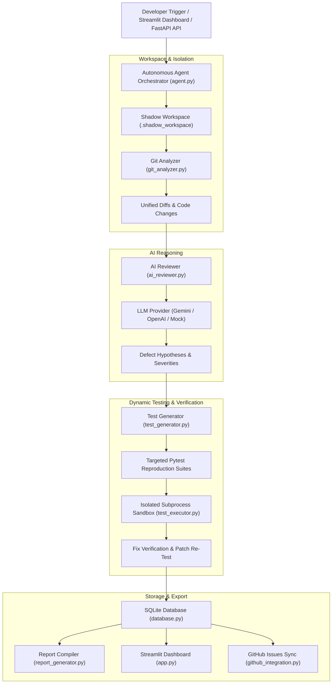

# 🛡️ Argus-AI: Autonomous Bug Detection & Verification Agent

[](https://www.python.org/)
[](#architecture)
[-success.svg)](#running-tests)
[](#1-interactive-streamlit-dashboard)
[](#3-fastapi-headless-service)

**Argus-AI** is a production-grade, agentic AI software engineering platform that autonomously reviews Git diffs, synthesizes defect hypotheses using LLMs (Google Gemini / OpenAI), auto-generates targeted Pytest reproduction test suites, executes tests in an isolated secure sandbox, and iteratively verifies code patches.

Built specifically to showcase **Agentic AI, Autonomous Execution Loops, Software Quality Engineering, and Safe Sandboxed Execution** for a competitive Software Engineering Intern role.

---

## 🌟 Key Capabilities

1. **Git Diff & Commit Analysis (`git_analyzer.py`):**  
   Extracts unified diffs, modified functions, and file contexts across commits or working-tree changes without mutating the host repo.
2. **AI-Powered Code Review (`ai_reviewer.py`):**  
   Utilizes LLM APIs (Google Gemini or OpenAI) to identify logical flaws, security vulnerabilities (e.g. SQL Injection), resource leaks, and boundary conditions.
3. **Automated Pytest Generation (`test_generator.py`):**  
   Synthesizes test suites asserting expected behavior against detected bugs with AST pre-validation.
4. **Isolated Sandboxed Execution (`test_executor.py`):**  
   Executes Pytest inside an ephemeral subprocess sandbox with sanitized environment variables (stripping host API tokens) and execution timeouts.
5. **Empirical Verification Loop (`agent.py`):**  
   Tests code before and after AI patch application to classify bugs into `CONFIRMED`, `FIXED`, or `SUSPECTED`.
6. **Multi-Format Audit Reports (`report_generator.py`):**  
   Compiles comprehensive Markdown (`.md`), standalone styled HTML (`.html`), and machine-readable JSON (`.json`) artifacts.
7. **GitHub REST API Integration (`github_integration.py`):**  
   Optionally creates formatted GitHub issues with defect descriptions, line numbers, and proposed patches.
8. **Interactive Streamlit Dashboard (`app.py`):**  
   A full-featured GUI displaying live execution steps, defect cards, diff inspectors, test execution telemetry, and historical trend analytics.
9. **FastAPI REST Service (`api.py`):**  
   Headless REST API for CI/CD pipeline triggers and automated webhooks.

---

## 🏗️ Architecture Overview



---

## 📂 Project Structure

```text
├── agent.py                 # Multi-stage autonomous agent execution loop
├── git_analyzer.py          # Git repository, commit, and unified diff analyzer
├── ai_reviewer.py           # LLM code reviewer and defect classification
├── test_generator.py        # Dynamic Pytest test suite synthesizer with AST validation
├── test_executor.py         # Isolated ephemeral subprocess test runner with sanitized env
├── github_integration.py    # GitHub REST API client for issue reporting
├── database.py              # SQLite relational persistence for runs, issues, and telemetry
├── report_generator.py      # Markdown, HTML, and JSON report generator
├── config.py                # Environment and application configuration manager
├── llm_provider.py          # Universal LLM interface (Gemini, OpenAI, Offline Mock)
├── app.py                   # Full-featured Streamlit interactive web dashboard
├── api.py                   # FastAPI REST service endpoint
├── setup_sample_repo.py     # Generator script for the demo vulnerable repository
├── requirements.txt         # Project dependencies
├── .env.example             # Environment variable template
├── ARCHITECTURE.md          # Architectural and security specification
├── sample_repos/
│   └── vulnerable_app/      # Real sample Git repo with SQL injection & off-by-one errors
├── tests/                   # Complete automated Pytest suite (15 passing tests)
│   ├── test_agent.py
│   ├── test_ai_reviewer.py
│   ├── test_database.py
│   ├── test_git_analyzer.py
│   ├── test_report_generator.py
│   ├── test_test_executor.py
│   └── test_test_generator.py
└── reports/                 # Output directory for audit reports (.md, .html, .json)
```

---

## 🚀 Quickstart & Setup

### 1. Installation
Clone the repository and install dependencies:
```bash
git clone https://github.com/Sriram12A/internship-project.git
cd internship-project

# Install required dependencies
pip install -r requirements.txt
```

### 2. Configure Environment (Optional)
Copy the example environment configuration:
```bash
cp .env.example .env
```
Edit `.env` to configure your preferred LLM provider:
- Set `LLM_PROVIDER=gemini` and add your `GEMINI_API_KEY`, or
- Set `LLM_PROVIDER=openai` and add your `OPENAI_API_KEY`, or
- Leave as `LLM_PROVIDER=mock` for **instant offline demonstration** without needing any API keys!

### 3. Initialize the Sample Vulnerable Repository
Generate the demonstration Git repository with real defect history:
```bash
python setup_sample_repo.py
```

---

## 💻 Running the Application

### Option A: Interactive Streamlit Dashboard (Recommended)
Launch the graphical console:
```bash
streamlit run app.py
```
Open [http://localhost:8501](http://localhost:8501) in your browser:
- **Run Analysis:** Click **"Load Built-in Vulnerable Demo Repo"** and hit **"Start Autonomous Agent Analysis"**.
- **Detected Defects:** Filter issues by Severity (`CRITICAL`, `HIGH`, `MEDIUM`) and examine original code vs suggested patches.
- **Test Execution Lab:** Review auto-generated Pytest reproduction code and isolated sandbox output.
- **Telemetry & History:** View bar charts of defects by severity and category across historical runs.
- **Reports & GitHub Sync:** Download standalone Markdown and HTML audit reports.

---

### Option B: Command Line (CLI) Script Execution
Run the agent autonomously on any Git repository via Python:
```python
from agent import BugDetectionAgent

# Instantiate agent in shadow mode with offline mock or Gemini LLM
agent = BugDetectionAgent(llm_provider_name="mock", shadow_mode=True, auto_verify=True)

# Run autonomous analysis on sample repo
result = agent.run("sample_repos/vulnerable_app")

print(f"Bugs Detected: {result['total_bugs']}")
print(f"Confirmed via Test: {result['confirmed_bugs']}")
print(f"Verified Fixes: {result['fixed_bugs']}")
print(f"Report path: {result['reports']['markdown']}")
```

---

### Option C: Headless FastAPI REST Service
Start the FastAPI server:
```bash
uvicorn api:app --host 127.0.0.1 --port 8000 --reload
```
Trigger an analysis via `curl`:
```bash
curl -X POST "http://127.0.0.1:8000/api/v1/analyze" \
     -H "Content-Type: application/json" \
     -d '{"repo_path": "sample_repos/vulnerable_app", "provider": "mock", "shadow_mode": true}'
```

---

## 🧪 Running Unit Tests

Run the complete test suite:
```bash
python -m pytest tests -v
```

Expected output:
```text
tests/test_agent.py::test_full_agentic_workflow_execution PASSED
tests/test_agent.py::test_report_generation PASSED
tests/test_ai_reviewer.py::test_mock_reviewer_sql_injection PASSED
tests/test_ai_reviewer.py::test_mock_reviewer_boundary_condition PASSED
tests/test_ai_reviewer.py::test_generate_fix PASSED
tests/test_database.py::test_run_lifecycle PASSED
tests/test_database.py::test_issue_operations PASSED
tests/test_database.py::test_metrics_summary PASSED
tests/test_git_analyzer.py::test_git_analyzer_info PASSED
tests/test_git_analyzer.py::test_git_analyzer_commits_list PASSED
tests/test_git_analyzer.py::test_git_analyzer_diff_extraction PASSED
tests/test_git_analyzer.py::test_shadow_workspace_creation PASSED
tests/test_test_generator.py::test_test_generation_reproduction PASSED
tests/test_test_generator.py::test_test_executor_isolated_pass PASSED
tests/test_test_generator.py::test_test_executor_isolated_failure PASSED

======================== 15 passed in 7.89s ========================
```

---

## 🔒 Security & Sandboxing Features

- **Shadow Workspace Mode:** Clones repositories to an isolated scratch folder before running analysis, guaranteeing zero accidental edits or commits to your original code.
- **Environment Sanitization:** Subprocess sandbox strips all host secrets (`GEMINI_API_KEY`, `OPENAI_API_KEY`, `GITHUB_TOKEN`, AWS credentials).
- **Execution Timeout Guard:** Pytest runs are constrained to a strict 15-second timeout to prevent DoS attacks or infinite loops.
- **AST Pre-Compilation:** All synthesized test code is parsed with `ast.parse` before saving to disk to prevent syntax corruption.

---

## 👨‍💻 Author

**BATCHU HANUMATH VENKATA NAGA SRIRAM**  
*B.Tech Computer Science & Engineering (AI & ML) | SRM Institute of Science and Technology*  
- **Email:** [nagasriram2006@gmail.com](mailto:nagasriram2006@gmail.com)  
- **LinkedIn:** [linkedin.com/in/sri-ram-353422330](https://www.linkedin.com/in/sri-ram-353422330)  
- **GitHub:** [github.com/Sriram12A](https://github.com/Sriram12A)

